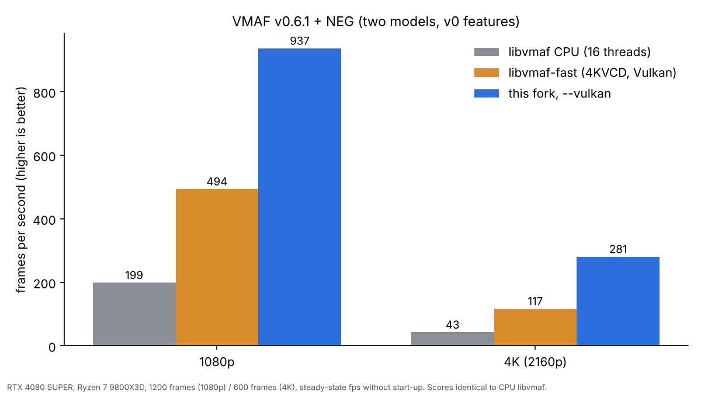
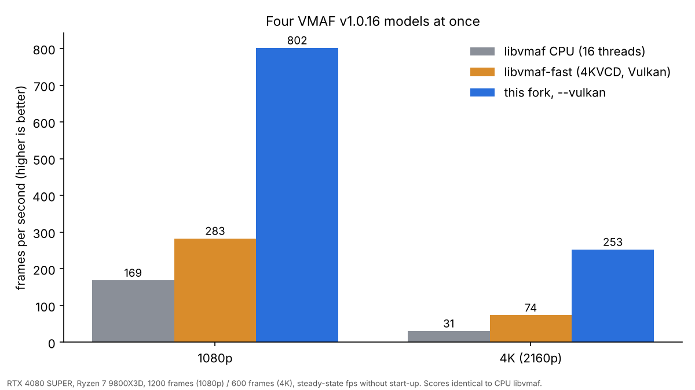

# VMAF with Vulkan compute

A fork of [Netflix/vmaf](https://github.com/Netflix/vmaf) that runs the VMAF feature extractors on a Vulkan GPU (tested on NVIDIA and AMD) and gives the same scores as the CPU code.

`libvmaf` already offers CUDA for a few features, but only on NVIDIA. This fork adds a vendor-neutral Vulkan backend to `libvmaf` itself, so the `vmaf` command-line tool and FFmpeg's `libvmaf` filter benefit without any other changes.

## What it adds

- **Vulkan feature extractors** for everything VMAF v0 and v1 models need: motion, VIF, ADM, CAMBI and SpEED (`motion_vulkan`, `vif_vulkan`, `adm_vulkan`, `cambi_vulkan`, `speed_chroma_vulkan`). Models pick the Vulkan version of a feature automatically and fall back to the CPU one for options the GPU code does not cover.
- **Same scores as the CPU.** Every feature of every frame is compared against the CPU extractors in CI (on lavapipe) and on real GPUs, for 8 to 16 bit, 4:2:0, 4:2:2 and 4:4:4, and odd frame sizes. VMAF v0.6.1, v0.6.1neg and the v1.0.16 models are covered.
- **Several models in one pass.** Models share one set of GPU features, so scoring four v1 models costs far less than four runs.
- **No hard dependency.** The Vulkan loader is opened at run time; builds without `-Denable_vulkan` are unchanged, and a machine without Vulkan simply keeps using the CPU.
- Based on current Netflix/vmaf master (v3.x, including the v1 models), so everything upstream offers still works.

## Benchmarks

Scoring speed in frames per second, wall clock of the `vmaf` tool, start-up excluded (the Vulkan loader and driver need about 135 ms once per process). RTX 4080 SUPER, Ryzen 7 9800X3D, Windows, 1200 frames at 1080p and 600 frames at 4K. The CPU runs use this fork's CPU code with 16 threads; [libvmaf-fast](https://github.com/4KVCD/libvmaf-fast) (4KVCD's Vulkan VMAF library) is shown for comparison.

| | 1080p | 4K |
|---|---|---|
| VMAF v0.6.1 + NEG: libvmaf CPU | 199 | 43 |
| VMAF v0.6.1 + NEG: libvmaf-fast | 494 | 117 |
| **VMAF v0.6.1 + NEG: this fork** | **937** | **281** |
| 4 v1.0.16 models: libvmaf CPU | 169 | 31 |
| 4 v1.0.16 models: libvmaf-fast | 283 | 74 |
| **4 v1.0.16 models: this fork** | **802** | **253** |





Notes: the 4K results with v0.6.1 + NEG are limited by the `vmaf` tool reading the input, not by the GPU. Running a single v1 model is faster on libvmaf-fast at 1080p. Its ideas (sliding CAMBI counts, fused passes) were a useful reference, thank you to its authors.

## Build and use

Needs the Vulkan headers and `glslc` or `glslangValidator` at build time, and a Vulkan driver at run time.

```sh
meson setup libvmaf libvmaf/build -Dbuildtype=release -Denable_vulkan=true
ninja -C libvmaf/build
```

```sh
# CPU features, Vulkan features on the first GPU found (or pick one: --vulkan=1)
libvmaf/build/tools/vmaf -r ref.y4m -d dist.y4m --vulkan \
    -m path=model/vmaf_v0.6.1neg.json -o score.json --json

# FFmpeg's libvmaf filter, built against this libvmaf
VMAF_VULKAN=auto ffmpeg -i dist.mp4 -i ref.mp4 -lavfi libvmaf -f null -
```

The C API is in `libvmaf/include/libvmaf/libvmaf_vulkan.h` (`vmaf_vulkan_state_init`, `vmaf_vulkan_import_state`, `vmaf_vulkan_state_free`). `VMAF_VULKAN_TIMING=1` prints a start-up and per-frame time breakdown. `libvmaf/test/vulkan/compare.sh` reproduces the CPU/GPU comparison.

## Original project

Everything else (models, papers, Python tools, documentation) is Netflix's work: **[github.com/Netflix/vmaf](https://github.com/Netflix/vmaf)**. Their docs in [`resource/doc`](resource/doc/index.md) still apply to this fork.

VMAF is licensed under [BSD+Patent](LICENSE), Copyright (c) 2020 Netflix, Inc.; the Vulkan additions are under the same license.
