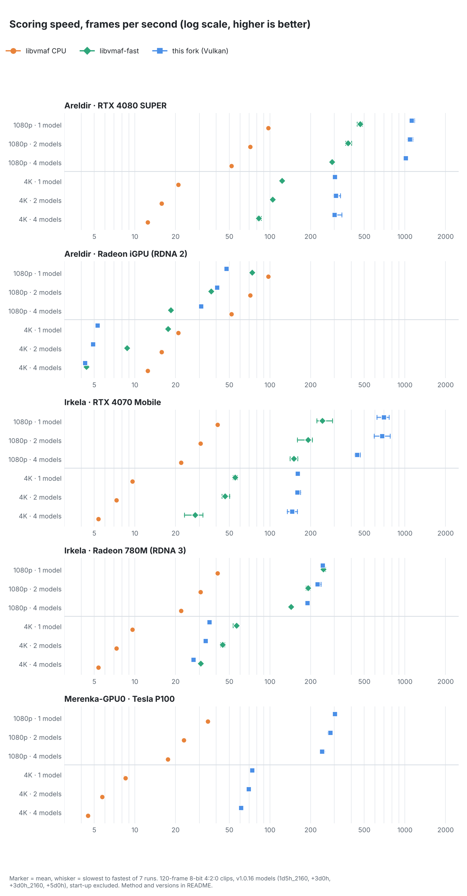

# VMAF with Vulkan compute

A fork of [Netflix/vmaf](https://github.com/Netflix/vmaf) that runs the VMAF feature extractors on a Vulkan GPU (tested on NVIDIA and AMD) and gives the same scores as the CPU code.

`libvmaf` already offers CUDA for a few features, but only on NVIDIA. This fork adds a vendor-neutral Vulkan backend to `libvmaf` itself, so the `vmaf` command-line tool and FFmpeg's `libvmaf` filter benefit without any other changes.

## What it adds

- **Vulkan feature extractors** for everything VMAF v0 and v1 models need: motion, VIF, ADM, CAMBI and SpEED (`motion_vulkan`, `vif_vulkan`, `adm_vulkan`, `cambi_vulkan`, `speed_chroma_vulkan`). Models pick the Vulkan version of a feature automatically and fall back to the CPU one for options the GPU code does not cover.
- **Same scores as the CPU.** Every feature of every frame is compared against the CPU extractors in CI (on lavapipe) and on real GPUs, for 8 to 16 bit, 4:2:0, 4:2:2 and 4:4:4, and odd frame sizes. VMAF v0.6.1, v0.6.1neg and the v1.0.16 models are covered.
- **Several models in one pass.** Models share one set of GPU features, so scoring four v1 models costs far less than four runs.
- **No hard dependency.** The Vulkan loader is opened at run time; builds without `-Denable_vulkan` are unchanged, and a machine without Vulkan simply keeps using the CPU.
- Based on current Netflix/vmaf master (v3.x, including the v1 models), so everything upstream offers still works.

## Benchmarks

Scoring speed in frames per second for 1, 2 and 4 VMAF v1.0.16 models scored in one pass, at 1080p and 4K, on three machines (five GPUs, one datacenter GPU). Each machine runs the CPU code of this fork, [libvmaf-fast](https://github.com/4KVCD/libvmaf-fast) (4KVCD's Vulkan VMAF library, Windows only) and this fork's Vulkan backend. Marker = mean, whisker = slowest to fastest of 7 runs; the axis is logarithmic and the same in every panel (3 to 2500 fps).

<picture>
  <source media="(prefers-color-scheme: dark)" srcset="docs/benchmark-v1-dark.png">
  <source media="(prefers-color-scheme: light)" srcset="docs/benchmark-v1-light.png">
  
</picture>

Mean fps, 4 models: the whole table with min and max is in [`docs/benchmarks/results.md`](docs/benchmarks/results.md), the raw per-run times in [`docs/benchmarks/`](docs/benchmarks) (`results.csv` and one JSON per machine and engine).

| | 1080p CPU | 1080p libvmaf-fast | **1080p this fork** | 4K CPU | 4K libvmaf-fast | **4K this fork** |
|---|--:|--:|--:|--:|--:|--:|
| Areldir, RTX 4080 SUPER | 52 | 290 | **1016** | 12 | 83 | **302** |
| Irkela, RTX 4070 Mobile | 22 | 151 | **444** | 5.3 | 28 | **146** |
| Irkela, Radeon 780M (RDNA 3) | 22 | 144 | **190** | 5.3 | 31 | 27 |
| Areldir, Radeon iGPU (RDNA 2) | 52 | 18 | **31** | 12 | 4.4 | 4.3 |
| Merenka, Tesla P100 | 17.5 | n/a | **244** | 4.5 | n/a | **61** |

What the numbers say: with a discrete GPU this fork is 2 to 4 times faster than libvmaf-fast and 20 to 25 times faster than the CPU, and it hardly slows down when more models are scored, because the models share one set of features. On integrated GPUs it is not always ahead: the 780M is level with libvmaf-fast at 1080p, and at 4K libvmaf-fast is faster on both integrated GPUs (4K on an RDNA 2 iGPU is even slower than the CPU). libvmaf-fast scores each model separately, so its speed drops with every model added. The P100 machine (Merenka-GPU1 is identical) has no libvmaf-fast result: its release is Windows only.

How it was measured, so you can repeat it:

- **Clips.** 120 frames of one 4K 60 fps source (`cabin-in-the-woods`, from 20 s), 8-bit 4:2:0, as raw `.yuv`; the 1080p clip is the same frames scaled with Lanczos. The distorted copy is x264 `-preset medium -crf 30`. Commands and SHA-256 of the raw files are in [`docs/benchmarks/clips/`](docs/benchmarks/clips); every machine verified the same hashes.
- **Models.** `vmaf_v1.0.16` `1d5h_2160`, then `+3d0h`, `+3d0h_2160`, `+5d0h` for 2 and 4 models. Scores are identical on CPU and on every GPU (mean 78.722213 for 1080p, 1d5h_2160).
- **Timing.** Every case runs twice, over 120 and over 24 frames, and the speed is 96 frames divided by the time difference, which removes process, loader and driver start-up (about 0.15 s with Vulkan). Seven repeats after a warm-up give min, mean and max. The CPU runs use the default thread count (the Merenka container has a 16-CPU quota). libvmaf-fast is driven from its Python API, one scorer per model, with its device forced to the GPU in question (`fast_dev.py` in each machine's folder).
- **Builds.** Release, static, `-DVMAF_ENABLE_VULKAN=ON`, with GCC 16.2 (Areldir), GCC 15.2 (Merenka) and clang-cl 23 (Irkela; the CPU numbers of the laptop are therefore not strictly comparable). Drivers, CPUs and OS versions are in `versions.txt` beside each machine's results.
- **Caveats.** Laptops are power-limited and the 4070 Mobile runs spread by up to 25 %; Areldir's NVIDIA GPU carried about 15 % desktop load. One run per machine and no thermal control: treat differences below 10 % as noise.

Reproduce: `python tools/bench/vmaf_bench.py --engine vulkan --vmaf build/tools/vmaf --models model --clips <clip dir> --device 0 --label "Machine · GPU" --out gpu.json`, then `python tools/bench/plot_bench.py docs/benchmarks docs/benchmark-v1` for the graphs and tables.

## Build and use

Needs the Vulkan headers and `glslc` or `glslangValidator` at build time, and a Vulkan driver at run time.

```sh
meson setup libvmaf libvmaf/build -Dbuildtype=release -Denable_vulkan=true
ninja -C libvmaf/build
```

```sh
# CPU features, Vulkan features on the first GPU found (or pick one: --vulkan=1)
libvmaf/build/tools/vmaf -r ref.y4m -d dist.y4m --vulkan \
    -m path=model/vmaf_v0.6.1neg.json -o score.json --json

# FFmpeg's libvmaf filter, built against this libvmaf
VMAF_VULKAN=auto ffmpeg -i dist.mp4 -i ref.mp4 -lavfi libvmaf -f null -
```

The C API is in `libvmaf/include/libvmaf/libvmaf_vulkan.h` (`vmaf_vulkan_state_init`, `vmaf_vulkan_import_state`, `vmaf_vulkan_state_free`). `VMAF_VULKAN_TIMING=1` prints a start-up and per-frame time breakdown. `libvmaf/test/vulkan/compare.sh` reproduces the CPU/GPU comparison.

## Original project

Everything else (models, papers, Python tools, documentation) is Netflix's work: **[github.com/Netflix/vmaf](https://github.com/Netflix/vmaf)**. Their docs in [`resource/doc`](resource/doc/index.md) still apply to this fork.

VMAF is licensed under [BSD+Patent](LICENSE), Copyright (c) 2020 Netflix, Inc.; the Vulkan additions are under the same license.
